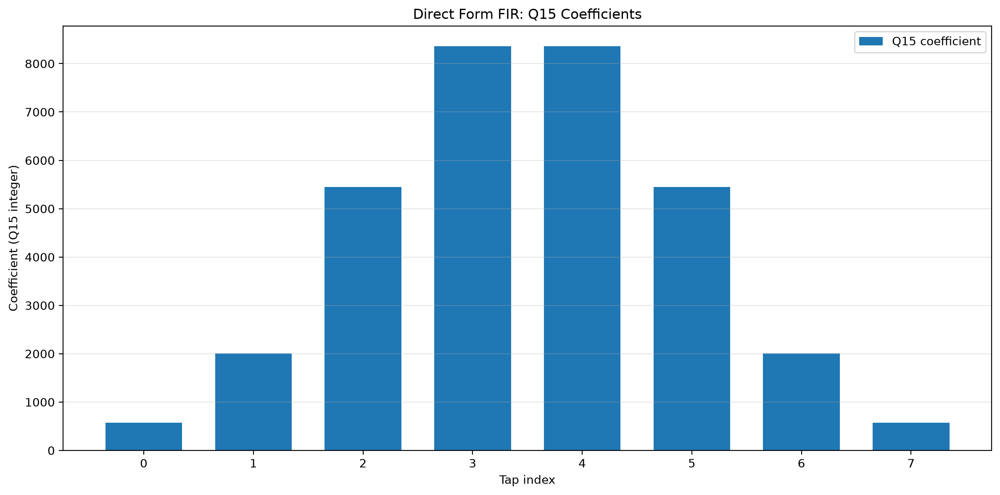
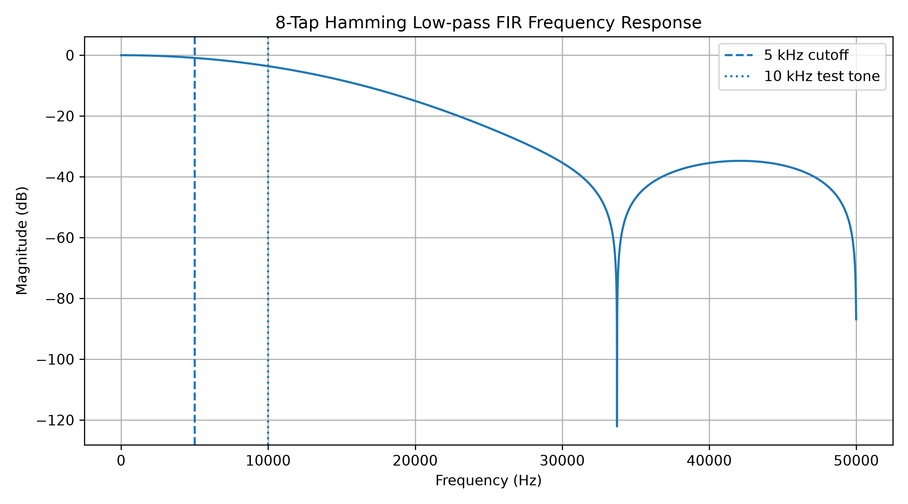
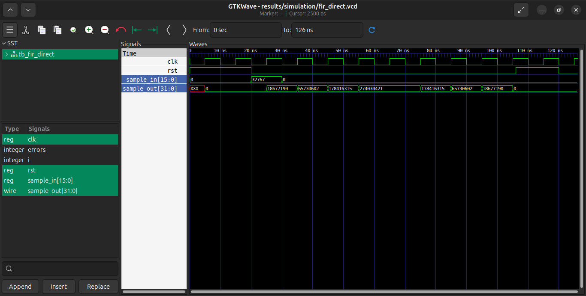
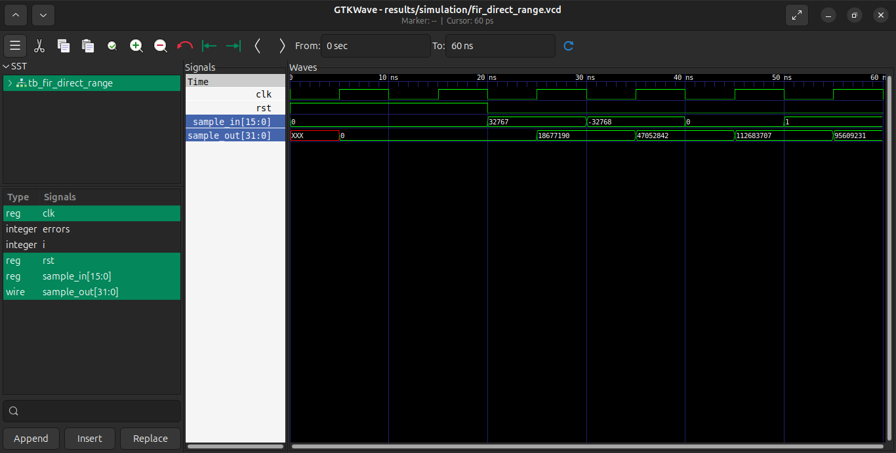
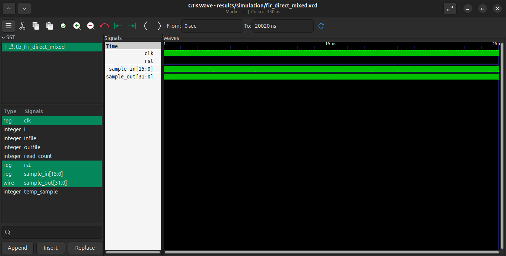

# FPGA Implementation of Optimized FIR Filter for Signal Processing

### A step-by-step Verilog and FPGA project for an 8-tap low-pass FIR filter.

**Status:** We have completed and verified the Direct Form FIR simulation. The Python reference comparison reports 0 mismatches across 2,000 samples. FPGA synthesis results are still pending.

| Project item | Status |
|---|---|
| Q15 coefficient design | Done |
| Direct Form FIR RTL | Done |
| Basic, range and mixed-signal simulations | Done |
| Python vs Verilog comparison | Done |
| Pipelined, Symmetric and Combined architectures | Planned |
| Vivado synthesis and implementation | In progress |

---

## Contents

- [FPGA Implementation of Optimized FIR Filter for Signal Processing](#fpga-implementation-of-optimized-fir-filter-for-signal-processing)
    - [A step-by-step Verilog and FPGA project for an 8-tap low-pass FIR filter.](#a-step-by-step-verilog-and-fpga-project-for-an-8-tap-low-pass-fir-filter)
  - [Contents](#contents)
  - [1. Tools and setup](#1-tools-and-setup)
    - [1.1 Linux tools](#11-linux-tools)
    - [1.2 Vivado and target device](#12-vivado-and-target-device)
  - [2. Filter design and Q15 coefficients](#2-filter-design-and-q15-coefficients)
    - [2.1 SciPy filter design](#21-scipy-filter-design)
    - [2.2 Q15 quantization](#22-q15-quantization)
    - [2.3 Frequency response](#23-frequency-response)
  - [3. Direct Form architecture](#3-direct-form-architecture)
    - [3.1 Delay line](#31-delay-line)
    - [3.2 Multiply and sum](#32-multiply-and-sum)
    - [3.3 Output scaling](#33-output-scaling)
  - [We verify this architecture with Verilog testbenches and compare its output with a Python integer reference. The simulation and comparison results are covered in the next sections.](#we-verify-this-architecture-with-verilog-testbenches-and-compare-its-output-with-a-python-integer-reference-the-simulation-and-comparison-results-are-covered-in-the-next-sections)
  - [4. Simulation and verification](#4-simulation-and-verification)
    - [4.1 Impulse test](#41-impulse-test)
    - [4.2 Range test](#42-range-test)
    - [4.3 Mixed 1 kHz + 10 kHz test](#43-mixed-1-khz--10-khz-test)
  - [5. Python vs Verilog comparison](#5-python-vs-verilog-comparison)

---

## 1. Tools and setup

We use Verilog HDL to describe the filter hardware. We use simulation to check its behaviour before evaluating it on an FPGA.

### 1.1 Linux tools

We use the following tools for development and verification.

| Tool | Purpose |
|---|---|
| Icarus Verilog | Compile and simulate Verilog |
| GTKWave | View simulation waveforms |
| Python, NumPy and SciPy | Generate coefficients and reference results |
| Matplotlib | Plot filter and simulation results |
| Git and GitHub | Track and publish project files |
| VS Code | Edit source code and documentation |

We run commands from the repository root.

```bash
cd ~/FIR-Filter-FPGA
```
### 1.2 Vivado and target device

We use Vivado 2023.2 for FPGA synthesis and implementation.

| Setting | Value |
|---|---|
| FPGA family | Artix-7 |
| Device | XC7A35T-1CPG236C |
| Clock constraint | 100 MHz |
| Timing status | Pending synthesis and implementation reports |

The clock constraint is a target for evaluation. It does not mean that timing closure has been achieved.

---

## 2. Filter design and Q15 coefficients

We use an 8-tap Hamming-window low-pass FIR filter. The sampling frequency is 100 kHz, and the cutoff frequency is 5 kHz.

The input uses signed 16-bit Q15 values. The output is signed 32-bit. We generate the coefficients with Python and SciPy, then quantize them to integers for Verilog.

### 2.1 SciPy filter design

The filter coefficients are generated with the project script.

```bash
python python/fir_coefficients.py
```

The generated Q15 coefficients are stored in `results/fir_coefficients_q15.csv`.

### 2.2 Q15 quantization

The eight quantized coefficients are:

| Tap | Q15 coefficient |
|---:|---:|
| 0 | 570 |
| 1 | 2006 |
| 2 | 5445 |
| 3 | 8363 |
| 4 | 8363 |
| 5 | 5445 |
| 6 | 2006 |
| 7 | 570 |

The coefficients are symmetric. Their integer sum is 32768.



*The plot shows the eight quantized coefficients used by the Direct Form filter.*

### 2.3 Frequency response

We check the filter response at 1 kHz, 5 kHz and 10 kHz.

| Frequency | Measured gain | Gain in dB |
|---:|---:|---:|
| 1 kHz | 0.9959 | -0.04 dB |
| 5 kHz | 0.9026 | -0.89 dB |
| 10 kHz | 0.6603 | -3.60 dB |



*The response shows the measured passband and attenuation for this 8-tap design. The 10 kHz component is attenuated, not completely removed.*

---

## 3. Direct Form architecture

The Direct Form implementation is the first architecture in this project. We use eight coefficients and a delay line to calculate the FIR output.

Source file: [`src/fir_direct.v`](src/fir_direct.v)

### 3.1 Delay line

The delay line stores the current input and previous input samples. On each rising clock edge, the stored samples move through the delay line. The synchronous reset clears the stored samples and output to zero.

### 3.2 Multiply and sum

Each delayed sample is multiplied by its corresponding signed Q15 coefficient. The products are added to calculate the output.

The RTL uses integer arithmetic. It does not use floating-point calculations.

### 3.3 Output scaling

The output is the raw sum of the products. We do not shift the result back to Q15. Therefore, the output retains the Q30 product-sum scale and is stored in a signed 32-bit value.

See [Output Scaling Decision](docs/project/Output_Scaling_Decision.md) for the project's scaling convention.

We verify this architecture with Verilog testbenches and compare its output with a Python integer reference. The simulation and comparison results are covered in the next sections.
---

## 4. Simulation and verification

We use Icarus Verilog to check the Direct Form FIR filter. We test its response to an impulse, input values near the signed 16-bit limits, and a mixed-frequency signal.

### 4.1 Impulse test

An impulse test checks the filter's response to one non-zero input sample followed by zero samples. The output follows the eight quantized FIR coefficients, multiplied by the input impulse value.



*The waveform shows the Direct Form filter response to an impulse input.*

### 4.2 Range test

We test positive, negative and zero input values. The test checks the signed input handling and confirms that reset clears the output and delay line.



*The waveform shows the tested input extremes and corresponding filter outputs.*

### 4.3 Mixed 1 kHz + 10 kHz test

The input contains a 1 kHz sine wave and a 10 kHz sine wave. The sampling frequency is 100 kHz. We use 2,000 samples for this test.

The 1 kHz component is in the passband. The 10 kHz component is attenuated by the filter. It is not completely removed.



*The waveform shows the input and output behaviour during the mixed-frequency test.*

The simulation completed for all 2,000 samples.

---

## 5. Python vs Verilog comparison

We compare the Verilog output with a Python integer reference. Both use the same Q15 coefficients and raw product-sum output convention.

The comparison checks every output sample. It also reports the input range and the maximum absolute error.

Run the comparison script from the repository root:

```bash
python python/compare_direct.py
```

The verified comparison output is:

| Measurement | Result |
|---|---:|
| Input samples | 2,000 |
| Verilog output samples | 2,000 |
| Q15 coefficients | 8 |
| Input range | -31,836 to 31,836 |
| Maximum absolute error | 0 |
| Mismatches | 0 |

The comparison passed. All Verilog output samples match the Python reference.

*The plot compares the Python reference output with the Verilog simulation output.*

See the [comparison console log](results/logs/compare_direct_console.txt) for the recorded results.
